  

  <b>Senior AI Engineer at Motorola Solutions</b>, designing multi-agent systems, mostly on AWS with some GCP. 
  After hours I build AI products end to end and run them myself. Every service on the board is live, so feel free to ride along.

  <a href="https://www.linkedin.com/in/rezart-abazi/">LinkedIn</a>
  &nbsp;·&nbsp;
  <a href="mailto:rezart392@gmail.com">rezart392@gmail.com</a>
  &nbsp;·&nbsp;
  <a href="https://rezart95.github.io/">rezart95.github.io</a>

 

## Departures

### Footbolski
**[footbolski.org](https://footbolski.org)** &nbsp;·&nbsp; [source code](https://github.com/rezart95/footbolski)

Runs the weekly pickup football game I play in Kraków: sign-ups with a waitlist, who has paid, and two fair teams. About twenty people have used it every week since May 2026, and the teams now get picked without the usual argument.

**Under the hood.** The model never picks the teams. In a LangGraph pipeline, Claude judges each player, an exhaustive solver builds the split, and Claude explains the result. My first version let the model do everything and left the sides 1.79 rating points apart; the solver gets that down to 0.03.

### MiredheLire
**[miredhelire.al](https://miredhelire.al)** &nbsp;·&nbsp; built with Illyrian AI

Price comparison for shoppers in Albania. It scrapes Albanian stores and lines up the same product across shops, around 19,730 products in its new catalogue.

**Under the hood.** A crew of specialised Claude agents, each with one job. Haiku reads a product's identity from messy listing titles. A Sonnet agent on the Claude Agent SDK decides which listings are the same product, using MCP tools for catalogue search, web search and page fetching. Sonnet files every product into the category tree. Next in line: an Opus repair agent, built but not yet deployed, that diagnoses broken scrapers and drafts the fixes as pull requests. Deterministic checks gate every verdict, and every model call lands in a cost ledger with a monthly budget.

### FashionPricing
**[fashionpricing.com](https://fashionpricing.com)**

Competitive pricing intelligence for Polish fashion brands: 26 brands tracked down to the price history of every size and colour.

**Under the hood.** Ask Emily, the in-app analyst: a LangGraph agent on Claude Sonnet with 15 read-only analytics tools, standing behind a Haiku guard that politely turns away anything off-topic. Every conversation is traced in Langfuse.

### Almanac
**[xtractor.financial-insights.uk](https://xtractor.financial-insights.uk)**

Turns a household's bank statements into a reconciled ledger with analytics. The household in question is mine, all two of us.

**Under the hood.** Categorisation by committee: rules and merchant matching first, then web enrichment through Perplexity and batch classification with Claude, asked two different ways. When the two answers disagree, a human gets the final word in a review queue.

### My Finances Analyst
**[my.financial-insights.uk](https://my.financial-insights.uk)**

Reads Bank Millennium statements with Azure AI Document Intelligence, sorts every transaction and charts 1,328 real transactions from 2019 to 2022, lockdown years included.

 

Also on this line: **[LegalHub](https://legalhub.al)**, a legal assistant for Albanian law, built on retrieval-augmented generation with LangGraph.

## On the job

<table>
  <tr><td><b>Now</b></td><td>Senior AI Engineer at Motorola Solutions. Multi-agent systems on AWS and GCP.</td></tr>
  <tr><td><b>Before</b></td><td>ALDI Tech Hub, building internal AI tools on Azure.</td></tr>
</table>

## Toolbox

<table>
  <tr><td><b>Agents</b></td><td>LangGraph, Claude Agent SDK, MCP, Anthropic API, OpenAI API</td></tr>
  <tr><td><b>Cloud</b></td><td>AWS, GCP, Azure</td></tr>
  <tr><td><b>Backend</b></td><td>Python, FastAPI, SQLAlchemy, PostgreSQL, Redis</td></tr>
  <tr><td><b>Frontend</b></td><td>React, Next.js, TypeScript, Tailwind CSS</td></tr>
  <tr><td><b>Operations</b></td><td>Docker, Terraform, Coolify, Cloudflare, Prometheus, Grafana</td></tr>
</table>

 

Board figures from each project's repo, Nov 2026.

