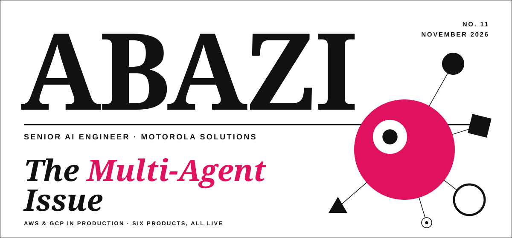
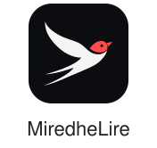

  

  I build multi-agent systems on AWS and GCP at Motorola Solutions. 
  The full stories are on <a href="https://rezart95.github.io/">rezart95.github.io</a>.

  <a href="https://footbolski.org"><picture><source media="(prefers-color-scheme: dark)" srcset="assets/logos/footbolski-dark.svg"></picture></a>
  <a href="https://miredhelire.al"><picture><source media="(prefers-color-scheme: dark)" srcset="assets/logos/miredhelire-dark.svg"></picture></a>
  <a href="https://fashionpricing.com"><picture><source media="(prefers-color-scheme: dark)" srcset="assets/logos/fashionpricing-dark.svg"></picture></a>
  <a href="https://xtractor.financial-insights.uk"><picture><source media="(prefers-color-scheme: dark)" srcset="assets/logos/almanac-dark.svg"></picture></a>
  <a href="https://my.financial-insights.uk"><picture><source media="(prefers-color-scheme: dark)" srcset="assets/logos/my-finances-dark.svg"></picture></a>
  <a href="https://legalhub.al"><picture><source media="(prefers-color-scheme: dark)" srcset="assets/logos/legalhub-dark.svg"></picture></a>

  AWS · GCP · Azure · LangGraph · Claude Agent SDK · MCP · Python · FastAPI · PostgreSQL · React · Docker · Terraform

  <a href="https://www.linkedin.com/in/rezart-abazi/">LinkedIn</a>
  &nbsp;·&nbsp;
  <a href="mailto:rezart392@gmail.com">rezart392@gmail.com</a>

