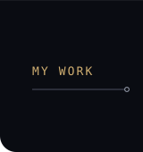
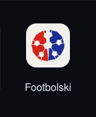
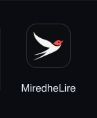
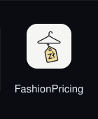
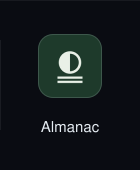
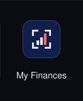

   
  

  LangGraph · Langfuse · MCP · RAG · Fine‑tuning · Python · FastAPI · PostgreSQL · React · Docker · AWS · GCP · Azure

  <a href="https://www.linkedin.com/in/rezart-abazi/">LinkedIn</a>
  &nbsp;·&nbsp;
  <a href="https://rezart95.github.io/">rezart95.github.io</a>
  &nbsp;·&nbsp;
  <a href="mailto:rezart392@gmail.com">rezart392@gmail.com</a>

